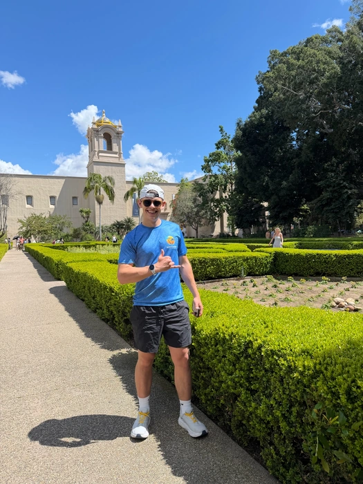
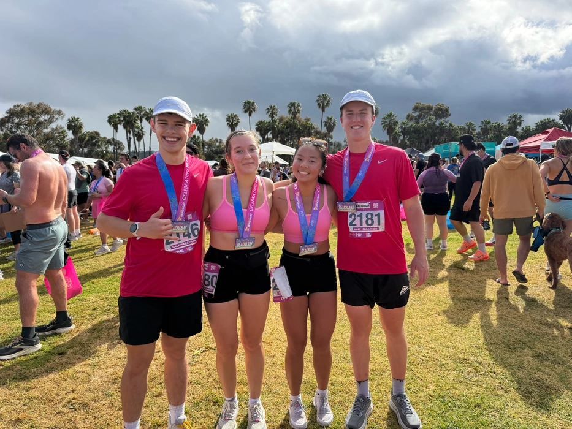
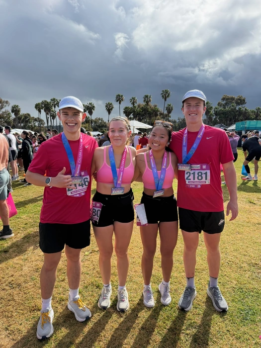
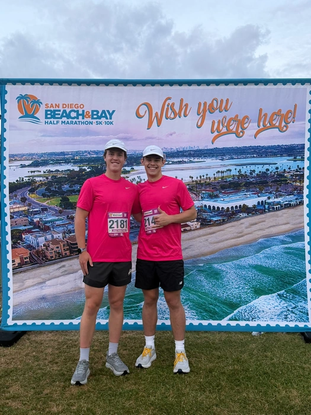
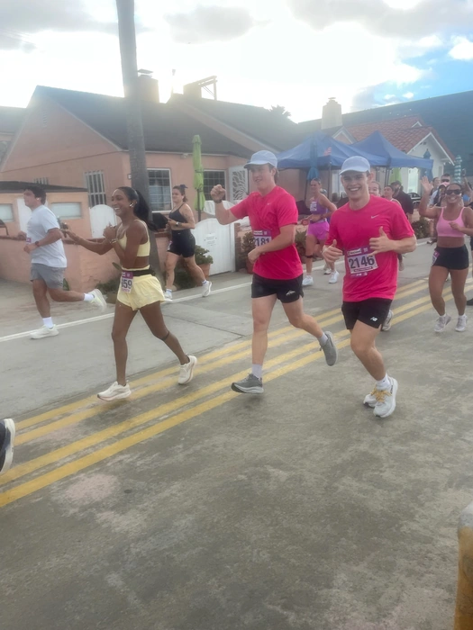
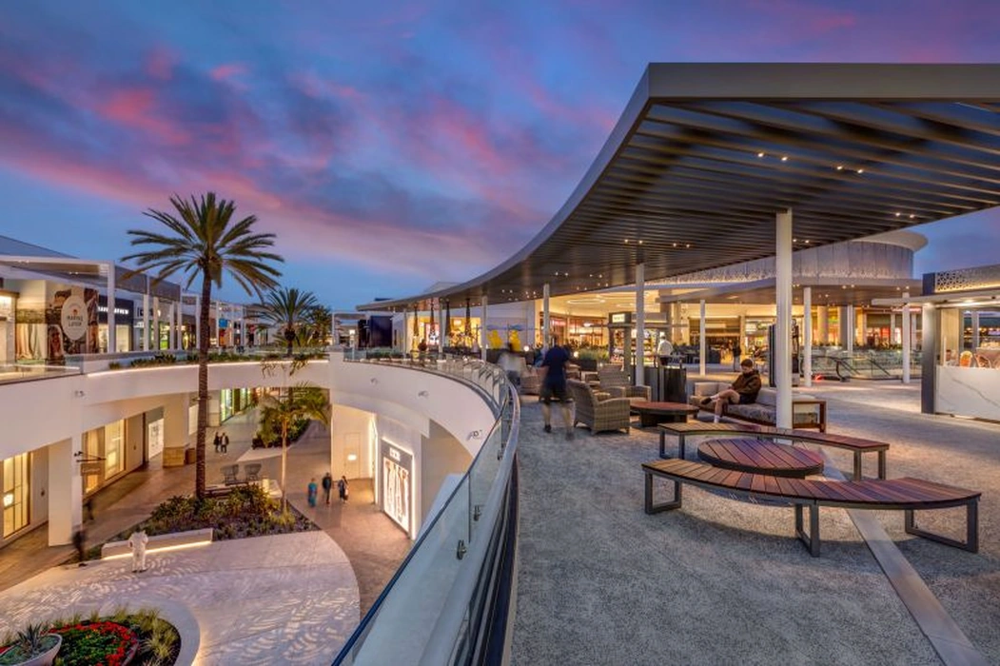
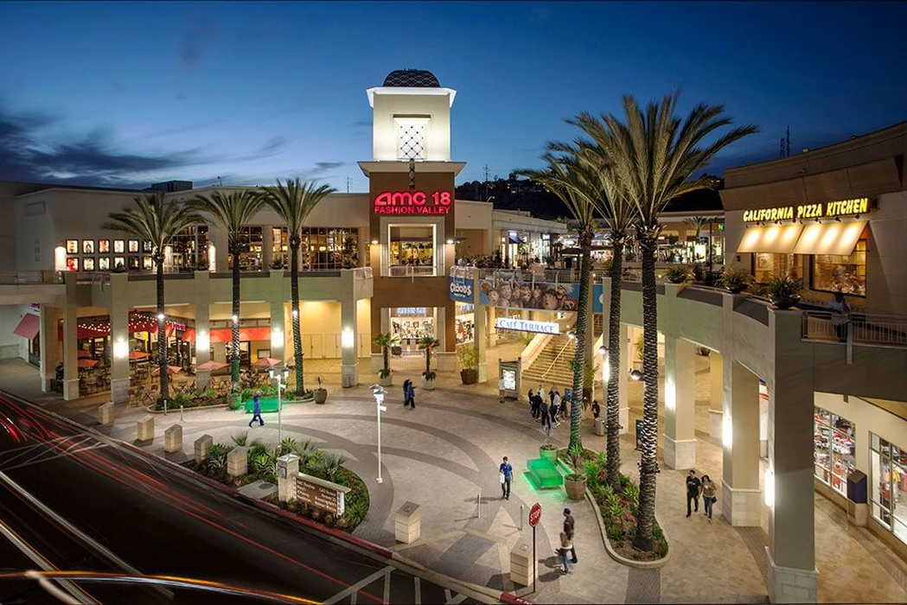

I reached out to the tech director at the SLO City church that I have been going to. I am going to start volunteering there doing camera work. He said I could shadow the sound guy as well. Hopefully I can get some experience and eventually do sound for some services.

I am going to San Diego today for a Half Marathon tomorrow morning. It is going to be a long drive (roughly 6-7 hours). I am going to drive part of it, and Clara is going to drive another part of it. I am going with my friends Tyler, Clara, Petra, Dahlia, and Clara's friend. We are staying at Petra's family friend's house. The marathon starts at 5am, I believe. My plan is to run with the group and just have fun. I'm not shooting for a fast time, just to have fun. I want to run a half marathon by myself sometime to see how fast I could do it.

I went to bed around 10:30 pm today.

I woke up today at 3:45am for the half marathon. I had a small breakfast and then Petra's Mom and Dad picked us up for the Half.

We got to the race and made it happen. Tyler and I ran with Petra and Dahlia for probably the first 5 miles. It went great! It started raining somewhere in there, and where we were running got pretty flooded. Tyler and I broke off from the girls and started doing our own pace. We really enjoyed passing people. It was fun to just try to pass more and more people.

With about 3 miles left in the race, I could tell that Tyler was itching to go faster, so I told him to send it. He immediately got going really fast.

I kept up a good pace, and toward the last quarter mile I saw a kid who looked to be 16 years old. I told him, "LET'S MAKE IT HAPPEN." And he and I started to push as hard as we could for the last bit of the race.

At the end of a run, I like to give it all that I can.

My final time was 1 hour 58 minutes.

After the race, we decided to stay in San Diego for the rest of the day. The house we stayed at was in Ocean Shores, so driving there, taking showers, and driving back would probably take 2 hours. So we decided to stay in San Diego.

Petra's Dad and Mom treated us to breakfast. We all ate a lot of food as you would expect.

We then met up with Clara and took her and her friend Olivia to UCSD, so we could use the car. I was a driver on the rental car, so Dahlia, Petra, Tyler, and I were able to drive the car around San Diego. We went to a roller coaster that they wanted to go on (near the race finish).

We then went to Balboa Park and spent a few hours exploring the museums there and the park in general.

Here is me at Balboa Park in my shirt from the race:

We then went to a cool shopping mall, which is very California.

We then drove back to UCSD and picked up Clara. We then drove to Ocean Shores where we were staying and then Clara left to go to UCSD. We showered and got cleaned up, and then took an Uber to "The Taco Stand", a place that Tyler really likes. It was pretty darn good!

We then came back and woke up early and drove home to San Luis Obispo.

The drive was 7 hours there and 7 hours back. I offered to drive many times, but Clara just sent it the whole way.
