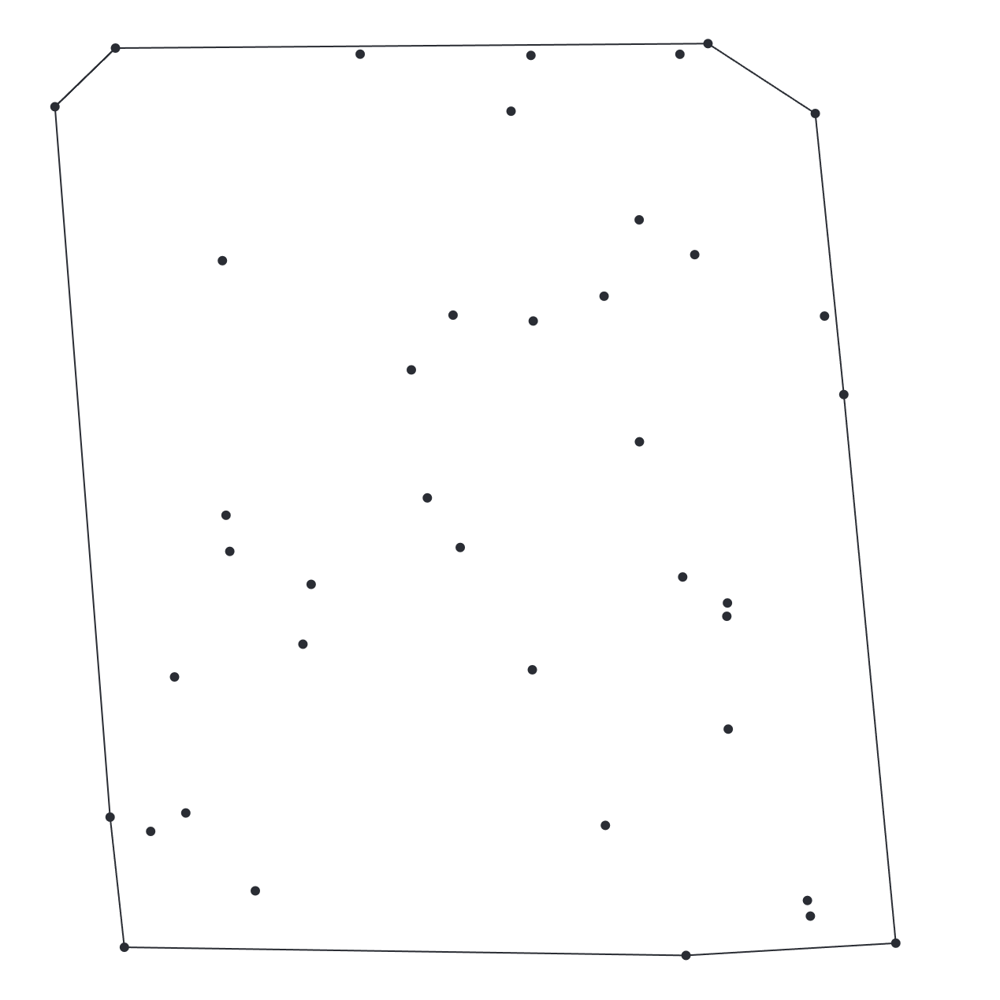

One challenge that is often approached in computer graphics is determining the boundary or the outermost points from a set of data. While this concept may seem confusing at first, let me break it down with an example.

Imagine a group of people standing together. Within this group, there will be people at the center of the group, and there will be people at the very edges. The people standing on the edges are the “boundary” points. They make up a boundary that contains all of the other people in the group. If you were to pull a string around the whole group, it would only touch the people on the outside. Those are the people that make up the boundary of the group.

Our brains can visualize this process, finding the outermost points or people, is obvious, but a computer doesn’t explicitly know how. When I first read about this challenge, the idea of it made sense. However, when I set out to tell the computer how to do this, I struggled.

I first decided to implement this procedure in two dimensions. You can see that below. Mastering two dimensions, I decided to implement this in three dimensions. You can see that **[HERE](../3d-convex-hull/index.md)**.

**Interactive demo:** [`demo/index.html`](demo/index.html)
