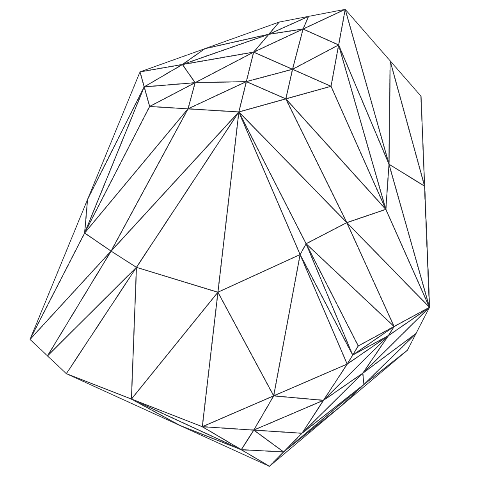

Visualize a school of fish. As they move through the ocean, there is the outer shell of fish that are on the outside of the group. There are also fish on the inside of the group. Imagine freezing the school of fish in place and wrapping it with gift wrap. You can hopefully visualize the shell that is created around the fish.

In computer graphics, this shell is called a convex hull. It is a structure that is created from some set of points in space. The objective is to find the points from the set, that, when connected, contain all the other points.

Our intuition can tell us what this would look like, but trying to teach a computer to do this is much more difficult. Computers don’t have the spatial understanding and reasoning that our brains do.

My objective when I learned about this task was to write a procedure that the computer could follow, to achieve this task. My first step in understanding this problem, was to create a 2 dimensional implementation. You can see that **[HERE](../2d-convex-hull/index.md)**. After mastering two dimensions, I decided to create the web graphic shown below.

**Interactive demo:** [`demo/index.html`](demo/index.html)
