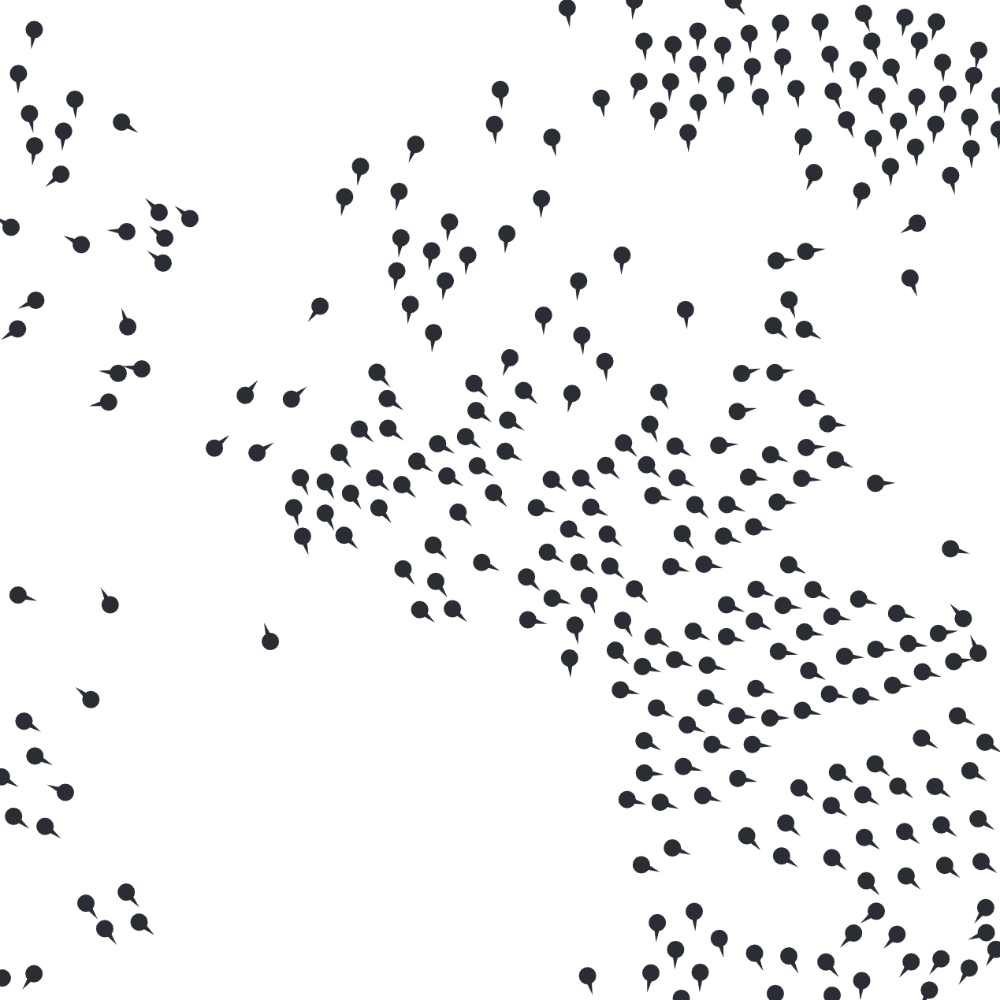

Depending on where you live, you may see flocks of birds flying overhead daily. They clump together in flocks, and when migrating for the winter, fly in a V shaped pattern. This seemingly random behavior has a cohesive nature to it. The birds, without communicating, can travel in the same direction, without hitting each other.

I think this natural flocking behavior is really cool. So, when I learned about a way for modeling this flocking, I jumped into action to start building a model. The person who captured the behavior of flocking birds is Craig Reynolds, a computer graphics expert.

His model described the flocking of birds in the following three different parts:

- **Cohesion** – Each bird will move towards the average position of its neighboring birds
- **Separation** – Each bird will move away the average position of its neighboring birds
- **Alignment** – Each bird will face in the direction of its neighboring birds
