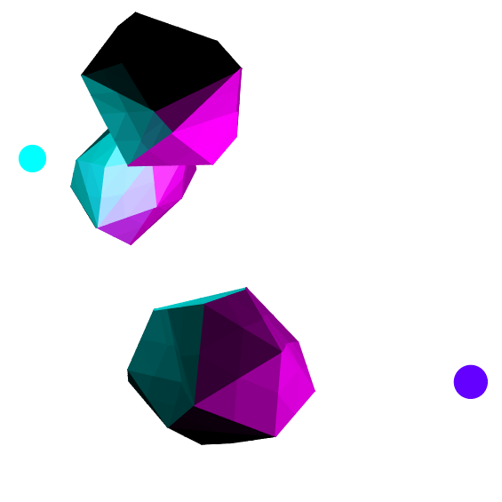

I built this renderer to render objects in a 3D environment. This was spurred from my 3D Convex Hull project, but I have since added on functionality to include complex lighting, camera systems, etc. You can see different examples of scenes and lighting by pressing the Previous and Next Scene buttons.

**Interactive demo:** [`demo/index.html`](demo/index.html)
