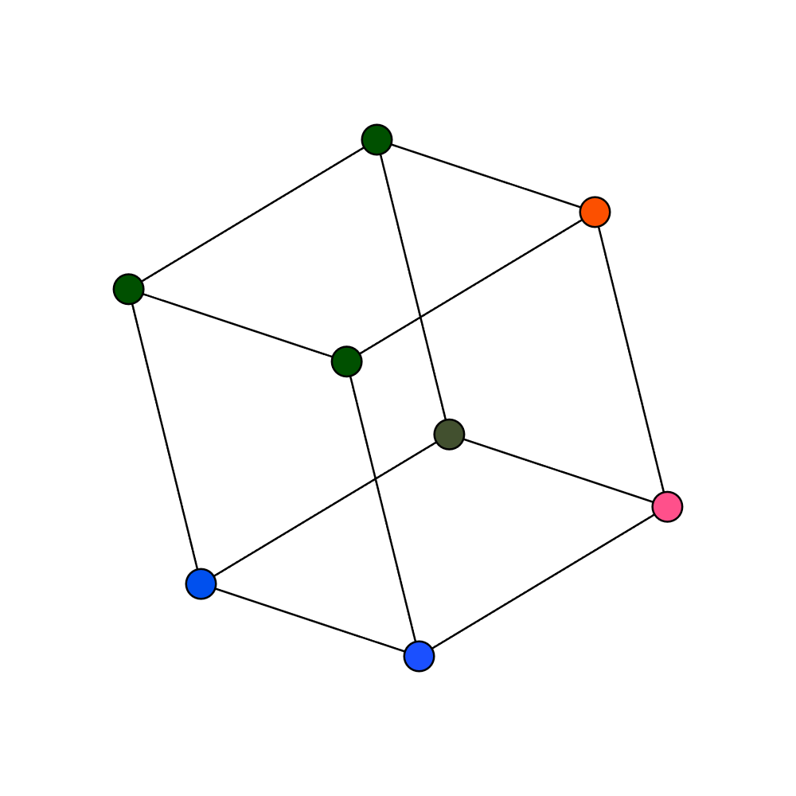

Throughout computer graphics, many different shapes of objects are used. Primitive shapes, such as cubes, prisms, cylinders, spheres and others are used to create more complex structures. When an animation is created, the need to rotate and reorient those shapes becomes important. Viewing a cube from the same angle, all the time would be boring.

There exists a method that allows the rotation of many points. This method uses rotation matrices. I wont go into the math behind these matrices, but all you need to know is the following: if you have a point (x, y, z), you can use a rotational matrix to rotate that point around the x, y and z axes. Then, if you want to rotate a whole object, like a cube, you can represent each corner of the cube as a point and from there individually rotate each point.

I have shown this process for rotating shapes below. You can use the **Play** button to start the rotation of the shape: every second the shape will be rotated more and more. You can use the **Pause** button to pause the rotation.

**Interactive demo:** [`demo/index.html`](demo/index.html)
