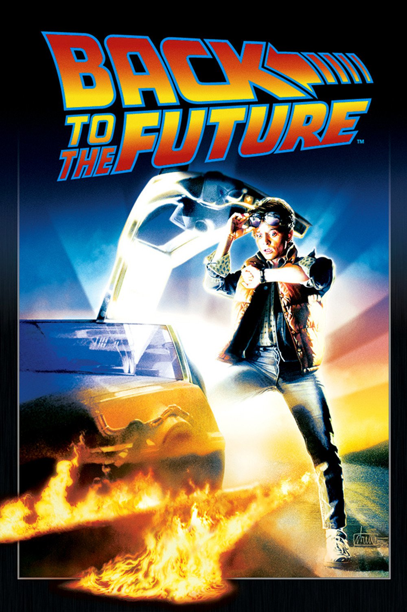
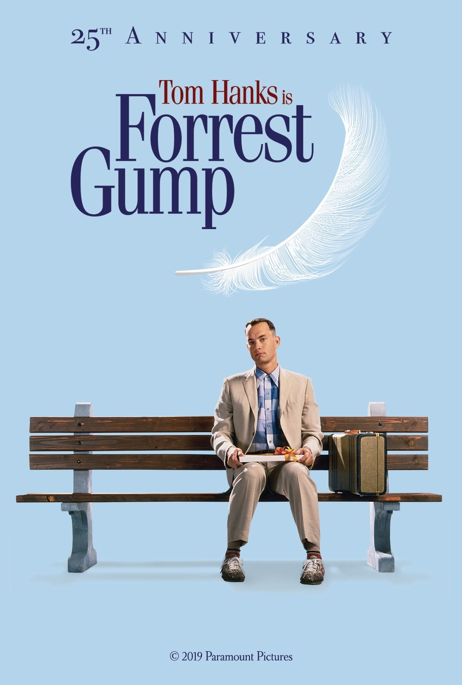
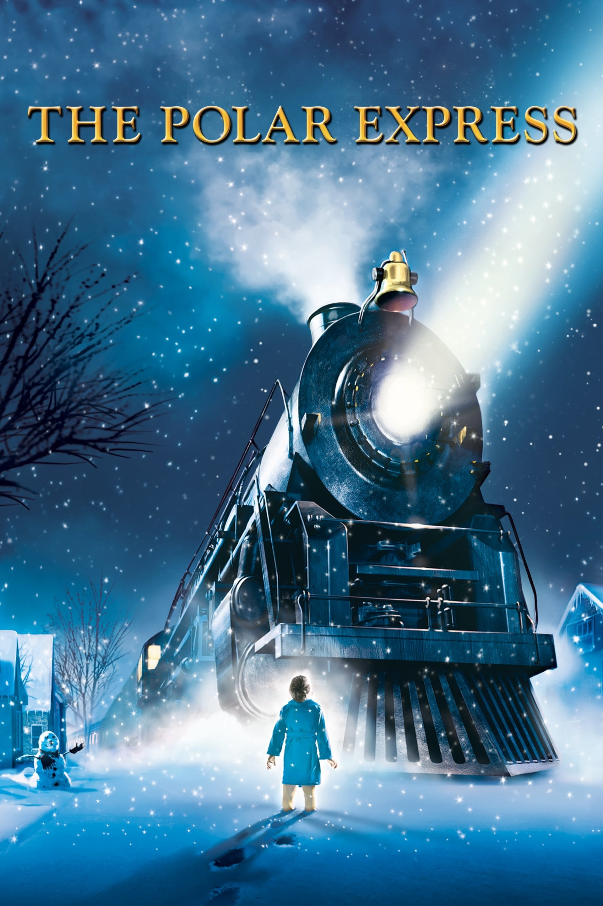
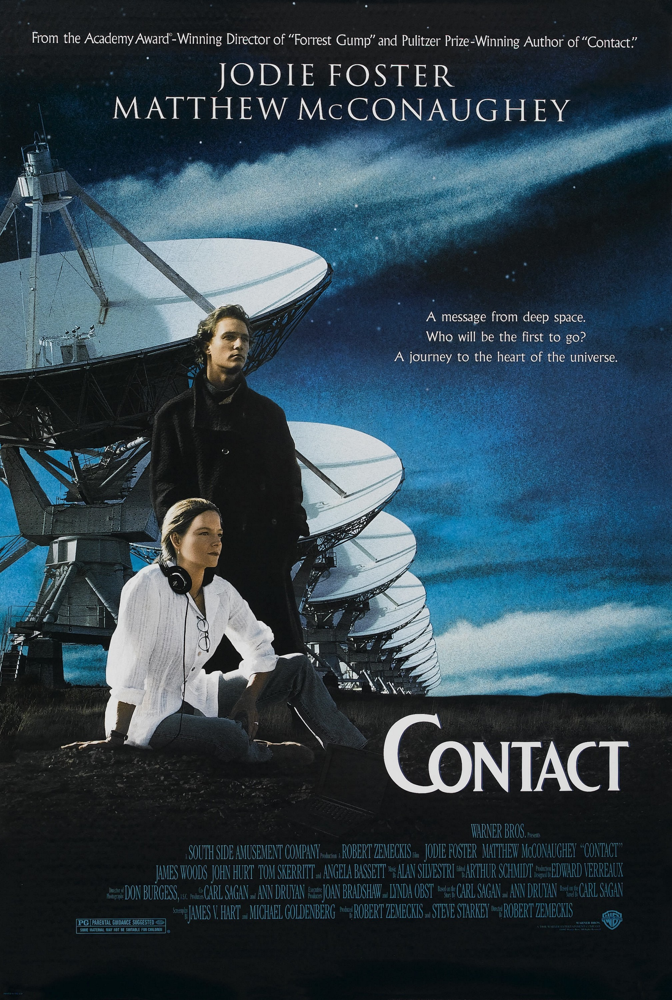
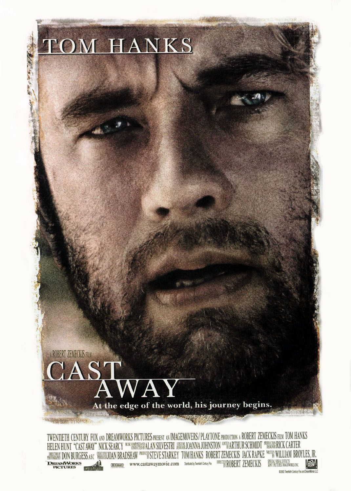
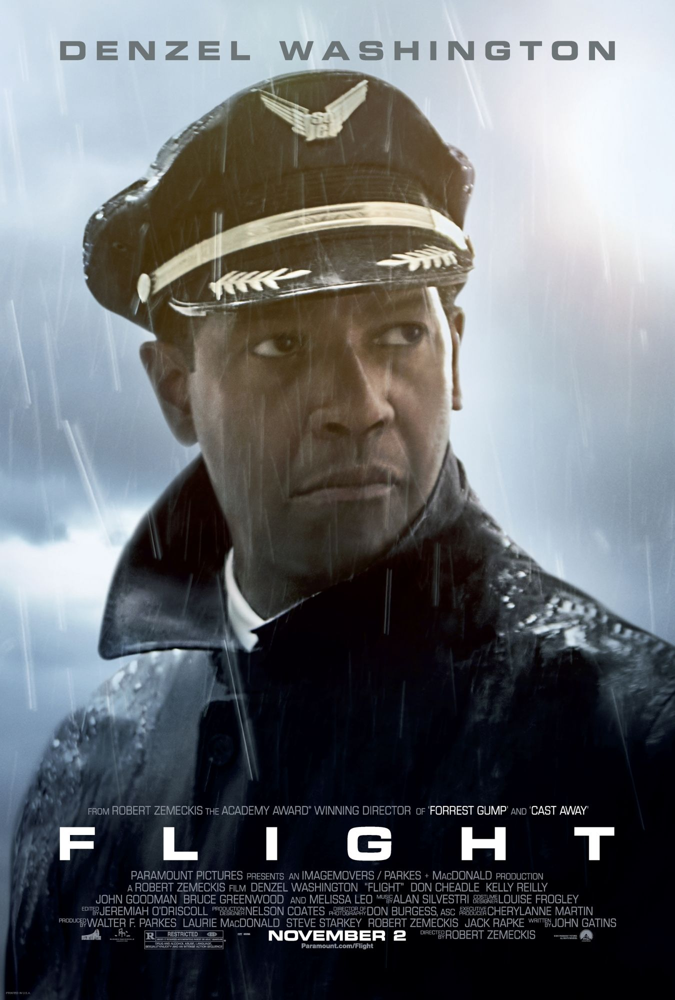

## About Robert Zemeckis

Robert Zemeckis is a ground-breaking filmmaker who blends cutting-edge visual effects with heartfelt stories. Each of his works of film set the bar high for filmmakers to come, and ensure that movies are exciting each and every time you watch them.

- [Read Luke Hoffmann's Written Analysis](analysis.md)
- [View Luke Hoffmann's Robert Zemeckis Presentation](zemeckis-presentation.pdf)

## Key Films

**Back to the Future (1985)** — A classic sci-fi adventure that brings a boy back in time.

**Forrest Gump (1994)** — A recollection of a man's life that uses visual effects to place him through time.

**The Polar Express (2004)** — A revolutionary film that used full body motions capture to spread Christmas spirit.

**Contact (1997)** — A sci-fi story about humanities first encounters with extra-terrestrial life, blends themes of aliens and religion.

**Cast Away (2000)** — A lonely and sad story of Tom Hanks' character who survives on a deserted island after his plane crash.

**Flight (2012)** — A story of an alcoholic pilot who saves the day, when mechanical trouble strikes. Stars Denzel Washington.
